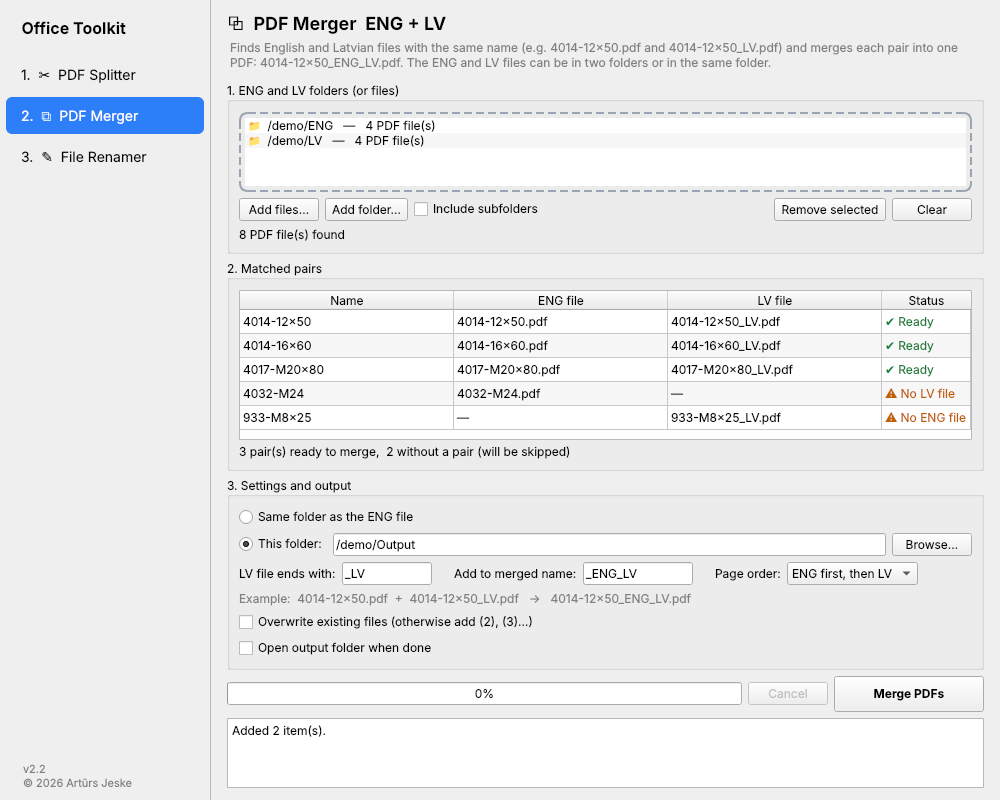
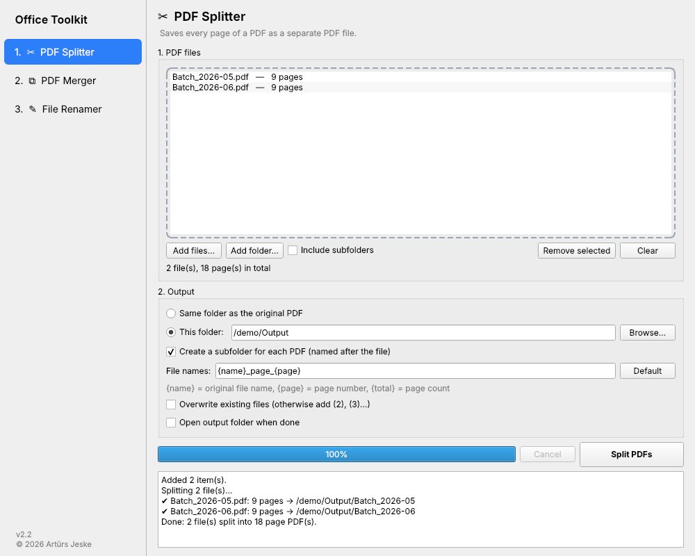
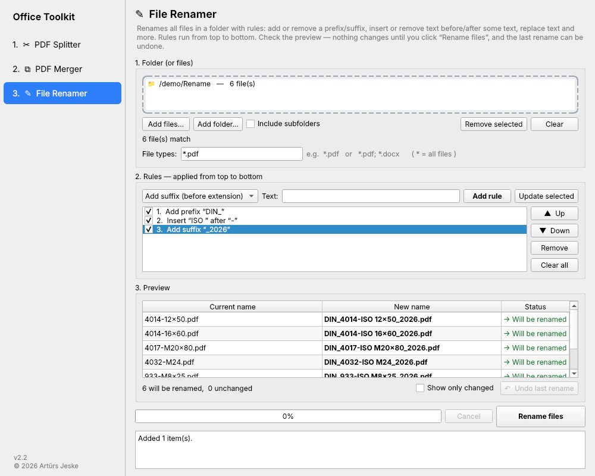

<h1 align="center">Office Toolkit</h1>

<p align="center">
  A small desktop app that automates repetitive office work with files —
  splitting and merging PDFs, and batch-renaming files.
</p>

<p align="center">
  
  
  
  
</p>

<p align="center">
  
</p>

---

## Contents

- [Features](#features)
- [Installation](#installation)
- [Usage](#usage)
  - [PDF Splitter](#pdf-splitter)
  - [PDF Merger (ENG + LV)](#pdf-merger-eng--lv)
  - [File Renamer](#file-renamer)
  - [Command line](#command-line)
- [Building a standalone .exe](#building-a-standalone-exe)
- [Project structure](#project-structure)
- [Adding a new tool](#adding-a-new-tool)
- [Changelog](#changelog)

## Features

| Tool | Description |
|---|---|
| **PDF Splitter** | Saves every page of one or more PDFs as separate PDF files. |
| **PDF Merger (ENG + LV)** | Pairs English and Latvian documents by file name and merges each pair into one PDF. |
| **File Renamer** | Renames all files in a folder using a stack of rules, with a live preview and undo. |

Across all tools:

- **Drag & drop** files and folders, or use the file dialogs
- **Preview before anything is written**, with clear warnings for conflicts
- **Never overwrites by accident** — existing files get a `(2)`, `(3)` suffix unless you choose otherwise
- **Runs in the background** with a progress bar and cancel button; the window stays responsive
- **Remembers your settings** — folders, options, rules and window size are restored on the next start

## Installation

**Requirements:** Python 3.10 or newer ([python.org](https://www.python.org/downloads/) — on Windows, tick *"Add Python to PATH"* during setup).

```bash
git clone https://github.com/<your-account>/office-toolkit.git
cd office-toolkit

python -m venv .venv
# Windows
.venv\Scripts\activate
# macOS / Linux
source .venv/bin/activate

pip install -r requirements.txt
```

**Start the app**

```bash
python app.py
```

On Windows you can also double-click **`run.bat`**, which starts the app without a console window.

## Usage

Select a tool in the sidebar on the left. Each tool follows the same flow: **add files → choose options → run**.

### PDF Splitter



Splits each PDF into single-page documents.

| Option | Description |
|---|---|
| Output | Next to the original PDF, or a folder of your choice |
| Subfolder per PDF | Puts each document's pages in a folder named after it |
| File name pattern | Default `{name}_page_{page}` → `Report_page_001.pdf`. Fields: `{name}`, `{page}`, `{total}` |

### PDF Merger (ENG + LV)

Merges English and Latvian versions of the same document into one file:

```
4014-12x50.pdf  +  4014-12x50_LV.pdf   →   4014-12x50_ENG_LV.pdf
```

1. Drop the English folder and the Latvian folder — or a single folder containing both.
2. Review the **Matched pairs** table:
   - ✔ **Ready** — both files found, will be merged
   - ⚠ **No LV file / No ENG file** — the counterpart is missing; skipped
   - ⚠ **Several files with this name** — ambiguous; skipped
3. Click **Merge PDFs**.

| Option | Default | Description |
|---|---|---|
| LV file ends with | `_LV` | Suffix that identifies the Latvian file (case-insensitive) |
| Add to merged name | `_ENG_LV` | Suffix added to the merged file's name |
| Page order | ENG first | ENG → LV, or LV → ENG |

Files that already end with the merged suffix are ignored, so running the tool again on the same folder never merges a result twice.

### File Renamer



Renames every file in a folder by applying rules **from top to bottom**. Works with any file type; the extension is never changed.

| Rule | Example — input `4014-12x50_LV` |
|---|---|
| Add prefix `CERT_` | `CERT_4014-12x50_LV` |
| Add suffix `_2026` | `4014-12x50_LV_2026` |
| Remove prefix `4014-` | `12x50_LV` |
| Remove suffix `_LV` | `4014-12x50` |
| Insert `DIN_` before `12x50` | `4014-DIN_12x50_LV` |
| Insert `-ISO` after `4014` | `4014-ISO-12x50_LV` |
| Remove everything before `12x50` | `12x50_LV` |
| Remove everything after `12x50` | `4014-12x50` |
| Replace `x` with `X` | `4014-12X50_LV` |
| Remove text `-` | `401412x50_LV` |
| Remove first / last *N* characters | — |
| Clean up spaces · UPPERCASE · lowercase | — |

- **File types** narrows the selection, e.g. `*.pdf` or `*.pdf; *.docx`.
- Text matching is **case-insensitive** unless *Match case* is ticked. *Before / after* rules use the first occurrence.
- Untick a rule to disable it temporarily; click a rule to edit it, and reorder with ▲ / ▼.
- **Safe by design:** files that would end up with the same name, or with a name that already exists, are flagged ⚠ and skipped. Renaming is done in two steps, so swaps (`A → B`, `B → A`) and case-only changes work on Windows.
- **Undo last rename** restores the previous names — even after the app has been restarted.

### Command line

The splitter and merger can also be run from a terminal (same engine as the app):

```bash
# Split
python split_pdf.py "C:\Certificates" -o "C:\Split"
python split_pdf.py report.pdf --no-subfolder --pattern "{name}-{page}"

# Merge
python merge_pdf.py "C:\ENG" "C:\LV" --dry-run        # list pairs only
python merge_pdf.py "C:\ENG" "C:\LV" -o "C:\Merged"
python merge_pdf.py "C:\Certificates" --lv-first      # one folder, LV pages first
```

Run either script with `--help` for all options.

## Building a standalone .exe

Create a single executable that runs on Windows machines without Python installed:

```bash
pip install pyinstaller
pyinstaller --noconsole --onefile --name "Office Toolkit" app.py
```

The result is `dist/Office Toolkit.exe`. Files dropped onto the `.exe` icon open in the last-used tool.

## Project structure

```
office-toolkit/
├── app.py              # Main window and sidebar (list of tools)
├── core/               # Business logic — no UI code
│   ├── common.py       #   shared helpers
│   ├── split.py        #   PDF Splitter
│   ├── merge.py        #   PDF Merger
│   └── rename.py       #   File Renamer
├── ui/                 # Qt pages
│   ├── widgets.py      #   shared parts: drop zone, output section, ToolPage base, worker thread
│   ├── split_page.py
│   ├── merge_page.py
│   └── rename_page.py
├── split_pdf.py        # CLI: splitter
├── merge_pdf.py        # CLI: merger
├── run.bat             # Windows launcher
└── requirements.txt
```

## Adding a new tool

The app is built so that each tool is self-contained:

1. **Logic** — add `core/<tool>.py` with plain functions (no Qt imports), so it can be tested and reused from the command line.
2. **Page** — add `ui/<tool>_page.py` with a subclass of `ToolPage`. Set `TITLE`, `ICON`, `DESCRIPTION`, `RUN_LABEL` and a unique `KEY`, build the layout in `build()`, and start work with `self.run_task(fn, total)`. `merge_page.py` is a good template.
3. **Register** — add the class to `TOOLS` in `app.py`. It appears in the sidebar automatically.

## Changelog

See [CHANGELOG.md](CHANGELOG.md).

---

<p align="center">
  Developed by <b>Artūrs Jeske</b> · 2026
</p>
